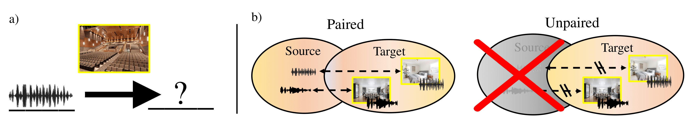

# Self-Supervised Visual Acoustic Matching

Official release of our **NeurIPS 2023** paper:

[**Self-Supervised Visual Acoustic Matching**](https://arxiv.org/abs/2307.15064)<br>
Arjun Somayazulu, Changan Chen, Kristen Grauman<br>
The University of Texas at Austin, FAIR

[Project page](https://vision.cs.utexas.edu/projects/ss_vam/) · [Paper](https://arxiv.org/abs/2307.15064)



Given an image of a target environment and source audio, SS-VAM learns to match the audio to that environment's acoustics. The release includes the visual/audio-only reverberators (`novas/`) and the SpeechBrain-based de-biaser with the acoustic residue metric (`recipes/metricgan/`).

## Dependencies

This is legacy research code. The original local environment uses **Python 3.7.13**, **PyTorch 1.12.1**, **PyTorch Lightning 1.7.6**, and **SpeechBrain 0.5.13**. `requirements.txt` records its main dependency versions; newer major releases are not drop-in replacements.

```bash
git clone https://github.com/arjunrs1/SS_VAM.git
cd SS_VAM
conda create -n ss-vam python=3.7.13 -y
conda activate ss-vam
python -m pip install 'pip<24.1' 'setuptools<68' wheel
# Select a PyTorch 1.12.1 build compatible with your CUDA driver.
python -m pip install torch==1.12.1 torchvision==0.13.1 torchaudio==0.12.1
python -m pip install -e .
python -m pip install -r recipes/metricgan/extra-requirements.txt
```

Install FFmpeg and a C/C++ compiler using your system package manager (needed for media processing and packages such as PESQ/pyroomacoustics). The older pip version is needed for Lightning 1.7's package metadata. Speech metrics and SRMRpy are installed from their upstream Git repositories.

Run every command below from the repository root. Use a CUDA GPU for training; `--accelerator cpu` is available for debugging the reverberator. The release has been checked for imports, CLI arguments, model execution, and packaging; full training and published-score reproduction have not been rerun for this cleanup.

## Datasets

Use the data released with [Visual Acoustic Matching](https://github.com/facebookresearch/visual-acoustic-matching). Data, generated audio, and model weights are downloaded or created separately and are not tracked by Git.

### SoundSpaces-Speech

Download the [metadata](http://dl.fbaipublicfiles.com/SoundSpaces/av_dereverb/metadata.zip), [training split](http://dl.fbaipublicfiles.com/SoundSpaces/av_dereverb/train.tar.xz), [validation subset](http://dl.fbaipublicfiles.com/SoundSpaces/av_dereverb/val-mini.tar.xz), [seen test split](http://dl.fbaipublicfiles.com/SoundSpaces/av_dereverb/test-seen.zip), and [unseen test split](http://dl.fbaipublicfiles.com/SoundSpaces/av_dereverb/test-unseen.tar.xz). Extract them under `data/soundspaces_speech/`, retaining the scene directories. The validation subset is suitable for development; the paper uses the experimental splits described in the paper.

The recipe uses metadata lists under `remove_oov/` containing paths to each split's `.pkl` examples. Each example contains `source_audio`, `receiver_audio`, `rgb`, `depth`, and the scene information consumed by the dataset loader. Audio is processed at 16 kHz. Keep paths in these lists relative to the repository root when moving data to another machine.

### Acoustic AVSpeech

Download [Acoustic AVSpeech](http://dl.fbaipublicfiles.com/vam/acoustic_avspeech.zip) and extract it under `data/acoustic_avspeech/`. The loader expects aligned `img/<id>.png` and `audio/<id>.wav` files with numeric IDs. This is the processed subset used by upstream VAM; see the paper and upstream repository for its filtering procedure and dataset terms. Optional experiments using random RIR convolution require `random_rir.pkl` as well.

### Directory layout

```text
data/
├── soundspaces_speech/
│   ├── train/<scene>/*.pkl
│   ├── val/<scene>/*.pkl
│   ├── test-seen/<scene>/*.pkl
│   ├── test-unseen/<scene>/*.pkl
│   ├── remove_oov/{train,val,test-seen,test-unseen}.pkl
│   ├── metric_dereverb/audio/*.wav       # generated in stage 1
│   └── metric_debias/rt60/audio/*.wav    # generated in stage 2
├── acoustic_avspeech/{img,audio}/
├── pretrained-models/rt60_estimator.pth
└── models/                             # your trained checkpoints
```

If the data is stored elsewhere, create a `data` symlink at the repository root. The historical `--dataset-dir` argument is not used by these loaders; the `data/` layout above is required.

## Code

### Training

The workflow trains an initial SRMR de-reverberator, learns visual and audio-only reverberators on its outputs, then uses their acoustic residue metric to train the de-biaser. See [the de-biaser recipe](recipes/metricgan/README.md) for the full sequence, data preparation, checkpoint arguments, and audio export.

To train a visual reverberator on SoundSpaces-Speech using generated SRMR audio:

```bash
python trainer.py --model wavenet --dataset soundspaces \
  --decode-wav --input-mono --output-mono --use-rgb \
  --use-metricgan-dereverb --remove-oov \
  --model-dir data/models/ss_srmr_vis --version v1 \
  --batch-size 16 --n-gpus 1 --max-epochs 60
```

For its audio-only counterpart, omit `--use-rgb` and use a separate `--model-dir` (for example, `data/models/ss_srmr_no_vis`). For Acoustic AVSpeech, use `--dataset avspeech` and omit `--remove-oov`. These are runnable starting configurations; use the paper's settings for a controlled reproduction.

`--use-metricgan-dereverb` reads `metric_dereverb/audio/`. `--use-metricgan-debias` reads generated de-biased audio instead. With neither flag, SoundSpaces uses the original source audio. Checkpoints and logs are written below `<model-dir>/<version>/`; `best_val.ckpt` is the validation-selected reverberator checkpoint.

### Testing

```bash
python trainer.py --model wavenet --dataset soundspaces \
  --decode-wav --input-mono --output-mono --use-rgb \
  --use-metricgan-dereverb --remove-oov --test --test-split test-unseen \
  --model-dir data/models/ss_srmr_vis --version v1 \
  --from-pretrained data/models/ss_srmr_vis/v1/best_val.ckpt
```

Use the same architecture and input flags used for training. Evaluation writes `test_stats_<split>.json` under the experiment directory. Use `--test-split test-seen` for seen environments.

The loader retains the original experiment naming convention for generated audio:

| Flags / split | Generated audio directory within the selected dataset |
| --- | --- |
| SRMR input, normal training / `--version v1` testing | `metric_dereverb/audio/` |
| De-biased input, training | `metric_debias/audio/` |
| De-biased input, `--version v1 --static-rt60-eval` testing | `metric_debias/rt60/audio/` |
| De-biased input, testing with another version | `metric_debias/dynamic_rt60/audio/` |

For SoundSpaces `test-seen` with a non-`v1` version, the loader additionally expects `seen_audio/` below the dynamic audio directory. See the recipe for creating the training audio link and exporting static/dynamic variants.

### Additional tools

- `python trainer.py --help`: reverberator options.
- `recipes/metricgan/hparams/train_dereverb.yaml`: de-biaser training settings.
- `as_scripts/`: data, visualization, and evaluation utilities.
- `notebooks/`: exploratory notebooks, with saved outputs removed. Some exploratory cells require local experiment paths and are not part of the training pipeline.

## Model checkpoints

Download the upstream [pretrained model bundle](http://dl.fbaipublicfiles.com/vam/pretrained-models.zip) and extract it under `data/pretrained-models/`. SS-VAM uses its `rt60_estimator.pth` to measure acoustic residue and evaluation errors. That bundle contains upstream VAM models, **not the trained SS-VAM pipeline**.

SS-VAM-specific trained weights are not bundled or linked in this release. Train the reverberators and de-biaser using the commands in the recipe, then supply your checkpoint paths. Existing local experiment checkpoints remain outside Git.

## Citation

```bibtex
@inproceedings{somayazulu2023selfsupervised,
  title={Self-Supervised Visual Acoustic Matching},
  author={Somayazulu, Arjun and Chen, Changan and Grauman, Kristen},
  booktitle={Advances in Neural Information Processing Systems},
  year={2023},
  url={https://arxiv.org/abs/2307.15064}
}
```

## License

The original root [Apache License 2.0](LICENSE) is retained. VAM-derived portions retain their CC BY-NC 4.0 license, and the SpeechBrain recipe retains Apache License 2.0. See [third-party notices](THIRD_PARTY_NOTICES.md) for component attribution and license copies. Datasets and downloaded weights are subject to their own terms.
